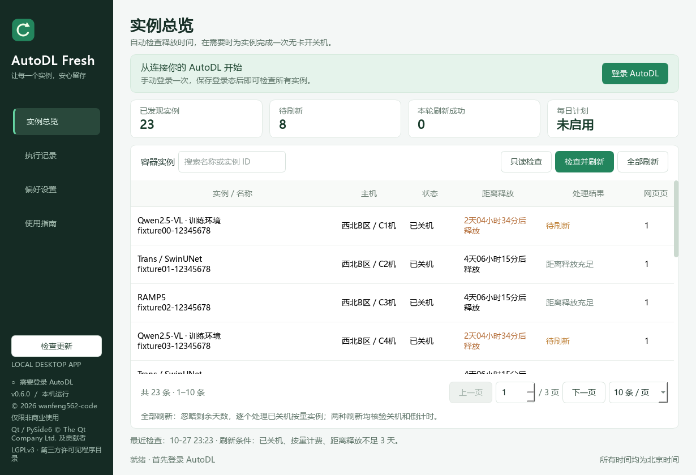

# AutoDL Fresh

AutoDL 普通容器实例的中文桌面保活助手，使用 Python、Playwright 和 PySide6 构建。

**当前正式版：0.6.0** · Windows 10 / 11 x64 · **仅限非商业使用**

开发版 **0.7.5** 新增「GPU 候租」，使用方法见下文。上方版本号及下载链接仍指向已发布的正式版。

[下载 Windows 正式版](https://github.com/wanfeng562-code/autodl-fresh/releases/download/v0.6.0/AutoDLFresh-0.6.0-windows-x64.zip)
| [发布说明](https://github.com/wanfeng562-code/autodl-fresh/releases/tag/v0.6.0)
| [许可协议](LICENSE)
| [更新日志](CHANGELOG.md)

## 功能

- 首次手动登录后保存 AutoDL 网站登录态；浏览器专用配置与日常浏览器隔离，禁用浏览器账号、同步和用户扩展。
- 只读检查遍历全部网页分页，并核对实例总数。
- **检查并刷新**：默认处理已关机、按量计费、距离释放不足 3 天的实例。
- **全部刷新**：忽略剩余天数，处理全部符合条件的已关机按量实例，不受主页分页或搜索影响。
- 逐个完成无卡开机、关机，并核验释放倒计时；失败时停止后续队列，保留恢复记录。
- 实例列表默认每页 10 条，可选 20 / 50 / 100 条，支持搜索、翻页和输入页码。
- 每日计划、系统托盘、可选 Windows 登录后自启动。
- 前台 / 后台模式、实例自动滚动定位、登录保存提示和空白窗口清理。
- 可查看和更换数据目录；设置中的下拉框和数值控件需先点击才能用滚轮修改。
- 逐显示器 DPI 支持，适配 Windows 系统缩放。
- 软件内检查 GitHub 最新正式版本，新版本提示、后台下载、取消和 SHA-256 校验。
- 0.7.5 开发版：同地区 GPU 候租，内置 JSON 参考报价、手动报价复核、优先顺序、卡数及等待时间配置，自动克隆系统盘与数据盘并开机，成功时通知。



## 下载使用

1. 下载上方 Windows 压缩包，解压整个 `AutoDLFresh` 文件夹。
2. 双击 `AutoDLFresh.exe`。**不要单独移动 exe**，`_internal` 和许可文件需与它一起保留。
3. 点击「登录 AutoDL」，在专用窗口中手动登录网站，再返回应用点击「保存登录态」。无需登录 Microsoft / Google 浏览器账号。
4. 先用「只读检查」核对实例。使用「检查并刷新」按阈值处理，或点「全部刷新」统一刷新。
5. 在「偏好设置」按需启用每日计划、自启动和后台模式，并保存设置。

默认使用已安装的 Microsoft Edge，无需安装 Python 或另行下载 Chromium。
首次登录始终显示浏览器；账号密码、扫码登录与人机验证由用户手动完成。
应用不绕过验证码，平台是否允许登录由 AutoDL 决定。

无卡开机会产生费用，以 AutoDL 的配置费、最低消费和实际计费规则为准。
每日任务需要本机开机、联网且应用运行；睡眠或退出时无法执行。恢复运行后可补检，
每个北京时间自然日最多自动尝试一次。手动全部刷新不改变每日任务的天数阈值。

升级前先从托盘退出旧程序，再启动新版。已有登录态和设置继续使用；
如启用了 Windows 自启动，在新版点一次「保存设置」更新启动路径。

## GPU 候租（0.7.5 开发版）

1. 保存 AutoDL 登录态后进入侧栏「GPU 候租」，点击「读取实例」，选择已关机且状态正常的源实例。
2. 选择源实例后自动显示该地区的 JSON 缓存型号与报价；「加载缓存型号与报价」也仅读取缓存，不打开浏览器。默认勾选原型号，也可勾选替代型号并调整优先顺序，4090、4090D 等精确区分。如需更新或该地区暂无缓存，请手动点击「重新核对报价」：这会在最小化浏览器中逐个勾选型号并读取主机表格，包括已占用主机，完整读取通常至少需要 2 分钟。进度与报价逐项更新，支持停止。
3. 设置卡数、刷新间隔（默认 1 秒，可选 1–3600 秒）及最长候租时间。无需配置费用上限。
4. 勾选计费确认，再点「开始候租并自动开机」。找到库存后按型号优先顺序、再按价格选机，按网页实际报价创建并开机一台后结束。
5. 确认新 GPU 已运行时，软件显示托盘通知、系统提示音、任务栏提醒及常驻成功提示，可查看结果或复制新实例 ID；数据盘完成拷贝后更新为已就绪。新实例保持 GPU 运行并持续计费，使用后自行关机；源实例保留。系统通知与声音是否呈现还受 Windows 通知设置影响。

系统盘与数据盘始终一并克隆，地区锁定在源实例地区，仅支持按量计费。参考报价为当前已读取主机的常规价格，会员优惠及最终费用以网页为准。
扩容数据盘按网页日价另行收费；软件保留源数据盘扩容容量，不因旧版费用上限阻止租用。

候租进入克隆页面后勾选全部选中型号，通过网页控件按空闲卡数降序排列主机；每轮仅取消再勾选优先列表中的最后一个型号，等待网页本轮请求及所有加载遮罩结束，再检查主机表格。空闲 GPU 足够时，在当前页面滚动定位、读取实际报价并点击创建。候租轮询和选机均不刷新浏览器、不重进克隆页；创建成功后的核验会进入实例列表。
没有库存时，每轮完成后等待设置的间隔再继续，默认 1 秒，网络耗时另计。短暂读取失败按 1、2、4、8…最多 30 秒退避（若配置间隔更长则采用该间隔）；恢复后回到正常间隔。登录过期或页面结构异常会停止。已发送的创建响应不确定时保留记录并暂停新下单。
实例读取和 GPU 型号/报价读取始终在后台最小化浏览器中执行，网页操作继续；候租、保活刷新和核验遵循前台 / 后台设置。首次手动登录仍使用可见专用窗口，保存后复用 AutoDL 网站登录态，过期时需重新手动登录。前台候租页会显示当前检查状态。
已保存的刷新间隔继续保留；从旧版升级后若仍显示 60 秒，可在候租页改为 1 秒。
创建成功后核验新实例的地区、型号、卡数、GPU 运行及数据盘拷贝成功状态。创建响应丢失或核验超时时保留记录，
暂停新的租用。已知新实例 ID 时使用「核验已创建实例」，不会再次下单。无法自动核验时，先到网页核对并接管实例，
再通过「网页核对后解除暂停」确认。此操作有明确的确认提示，避免误清记录后重复计费。

候租与保活任务串行执行，候租期间每日保活延后至浏览器空闲。停止候租或安全退出会停止新的创建；
已经接受的创建仍继续核验，不会自动关闭供你使用的新 GPU。重启后不会自动恢复候租，需重新手动开始。
电脑睡眠、退出应用或登录态过期时无法继续候租。

随程序提供的报价文件为 [autodl_fresh/data/gpu_quotes.json](autodl_fresh/data/gpu_quotes.json)，已纳入仓库和安装包，目前包含西北 B 区已核对的 20 个型号。文件只含地区、型号、参考价格、单位和核对时间，不含账号、实例或登录信息。界面显示报价来源及上次核对时间；尚未缓存的地区需要用户手动核对，不套用其他地区价格。

手动核对结果保存在数据目录的 `gpu-quotes.json`，优先于随程序提供的报价。同地区其他源实例可复用缓存；更新报价保留当前勾选、优先顺序和卡数。未读取到新价格时保留上次报价并明确标注。
**启动、缓存过期或电脑空闲均不会自动核价，也不再提供自动核价设置；只有用户点击「重新核对报价」才执行整轮读取。** 旧版自动复核配置会被忽略。缓存报价不会自动失效；候租仍实时检查库存，创建时以网页当前报价计费。

主机列表以整表快照读取，选机按唯一主机 ID 定位，避免网页重排后一直等待旧行号。浏览器或工作页关闭时明确提示；已提交的订单仍保留待核验记录，不会自动重复下单。

## 检查和下载更新

侧栏、托盘菜单或「偏好设置 → 软件更新」都可进入检查更新。
默认启动后在后台检查一次，可取消勾选「启动时自动检查更新」并保存。
只检查项目的公开正式 Release，不需要 GitHub 登录，不读取或上传 AutoDL 登录态。
没有新版本或自动检查遇到网络问题时不会弹窗打扰；发现新版时显示提示条和托盘通知。

点击「下载更新」选择 ZIP 保存位置。下载显示进度，支持取消，并在完成前核对
文件大小、SHA-256 和程序包结构。失败或取消会清理本次临时文件，原有文件保留。
可点击「打开下载目录」查看更新包。

本版支持下载更新包，不会在实例操作期间替换运行中的程序。
请先安全退出软件，再将整个文件夹解压到程序目录；数据目录中的登录态和设置保留。
0.5.0 没有内置更新入口，首次升级到 0.6.0 请使用上方下载链接。

## 执行与异常恢复

两种刷新都重新读取全部网页分页，并在每次开机前重新检查实例状态。
原本运行、非按量计费、倒计时不可识别或已到释放时间的实例不会被启动；
已有无卡实例运行或启动中时暂停刷新。仅支持普通容器实例，不操作 Pro 或弹性部署。
请在 AutoDL 表格列设置中保留实例 ID、状态、付费方式、释放时间和操作列。

开机必须获得平台成功响应，随后确认「运行中 + 无卡模式」，再关机并核验
「已关机 + 释放倒计时接近完整保留期」。通常还要求倒计时大于刷新前数值。
全部刷新遇到原本就接近完整保留期的实例时，允许分钟精度导致前后倒计时相同，
但仍须有平台已接受开机、关机和完整倒计时的证据。开机响应不确定时不会放宽核验或重复开机。

「停止后续操作」会停止剩余队列；已被平台接受的开机操作仍优先完成关机与核验。
异常恢复失败时保留实例快照和待核验记录。请在网页人工核对待处理实例；
已经确认关机且无进行中的开机操作时，可使用「解除暂停」重新读取状态并记录人工处理。

网络中断、断电或强制结束程序可能导致无法及时关机。重要数据请另行备份。
本软件不是 AutoDL 官方产品，与 AutoDL 不存在隶属或授权背书关系。

## 本地数据

默认位于 `%LOCALAPPDATA%\AutoDLFresh`。在「偏好设置 → 数据目录」查看或打开。
可选择独立空文件夹，点「保存并重启」复制设置、登录态和记录；原目录保留，
浏览器缓存重新生成。复制失败时仍使用旧目录，新旧目录不能互相包含。

- `auth.json`：AutoDL 登录态，**不要分享或提交到仓库**。
- `settings.json`、`scheduler.json`：设置与每日计划状态。
- `pending.json`：尚未完成操作的恢复记录。
- `history.json`、`activity.log`：执行摘要、实例快照和日志。
- `gpu-quotes.json`：用户手动核对的地区 GPU 型号、参考报价和核对时间。
- `browser-autodl-only-v1-*`：隔离浏览器配置及网站缓存，不要分享。

默认目录下的 `data-location.json` 记录所选路径，进程锁也固定保留在默认目录。
高级用户可用 `AUTODL_FRESH_DATA_DIR` 环境变量指定目录；该变量优先于界面设置。
应用仅保存 AutoDL 网站登录态，不读取日常浏览器配置或记录账号密码。

## 从源码运行

需要 Python 3.11+ 和已安装的 Edge / Chrome：

```powershell
python -m venv .venv
.\.venv\Scripts\python.exe -m pip install -e ".[dev]"
.\.venv\Scripts\python.exe run_app.py
```

也可双击 `setup.bat` 安装依赖，再用 `start.bat` 启动。
如选择 Playwright Chromium，先安装它并使用「Playwright 兼容模式」：

```powershell
.\.venv\Scripts\python.exe -m playwright install chromium
```

## 验证和构建

```powershell
.\.venv\Scripts\python.exe -m pytest -q
.\.venv\Scripts\python.exe -m ruff check autodl_fresh tests tools run_app.py
```

测试只访问本机模拟页面、临时专用浏览器和离屏 GUI，不使用用户登录态，
不访问真实 AutoDL 实例，也不产生云费用。普通窗口测试需要允许 Edge 渲染进程的桌面环境。

正式版对应的 Qt / PySide6 源码和许可收集：

构建前先安全退出输出目录中运行的程序；也可用 PyInstaller 的其他输出目录单独打包。

```powershell
.\.venv\Scripts\python.exe tools/collect_third_party.py
.\build.ps1
```

发布构建使用 Python 3.12.4、PySide6 / Shiboken 6.10.2、Playwright 1.64.1、
PyInstaller 6.19.0。构建输出 `dist\AutoDLFresh` 和 `releases` 下的 Windows 压缩包、
第三方源码包及 SHA-256 校验文件。第三方源码包不含本项目的非商业许可限制；
Qt / PySide6 的许可、源码位置和替换 / 重新链接说明见 [第三方声明](THIRD_PARTY_NOTICES.md)。

## 许可与版权

**Copyright (c) 2026 wanfeng562-code. All rights reserved.**

本项目原创代码、界面、图标及文档采用 [AutoDL Fresh 非商业使用许可 1.0](LICENSE)：
允许他人下载、非商业使用、研究、修改和免费分享；未经版权人单独书面授权，
禁止销售、收费服务、商业代运营、商业产品集成及其他商业用途。
**版权人本人保留商业使用、销售及另行商业授权的权利。**

这是源码可见的非商业授权项目，不是 MIT / Apache / GPL 授权的开源项目。
第三方库的版权和许可独立保留，非商业限制不覆盖它们。
商业授权请通过 [GitHub Issues](https://github.com/wanfeng562-code/autodl-fresh/issues) 联系版权人。
