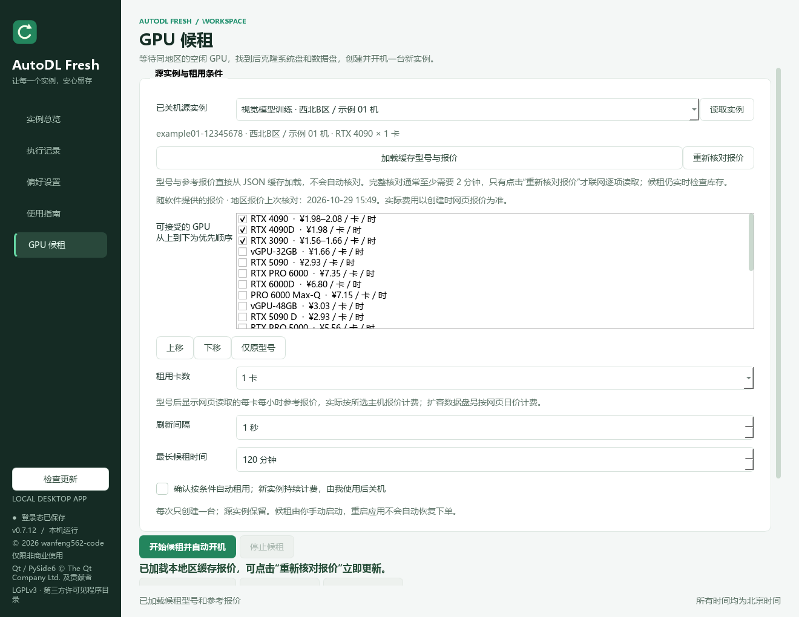

# AutoDL Fresh 0.7.12 正式版

2026-11-12 发布（北京时间）。适用于 Windows 10 / 11 x64。

- 克隆页超时后，候租会在原页面等待源实例、计费方式和地区选项就绪。源实例没有名称时，页面上的完整 ID 即可用于校验。
- 实际显示的源实例 ID 不符，或重试时网址中的源实例、地区、数据盘参数发生变化，程序会停止创建。
- 更新实例总览、GPU 候租配置和克隆核验三张截图。截图均使用模拟数据。



[实例总览](https://github.com/wanfeng562-code/autodl-fresh/blob/v0.7.12/docs/overview.png) · [克隆核验与人工确认](https://github.com/wanfeng562-code/autodl-fresh/blob/v0.7.12/docs/clone-verification.png) · [完整更新日志](https://github.com/wanfeng562-code/autodl-fresh/blob/v0.7.12/CHANGELOG.md)

旧版可通过软件内的「检查更新」下载。手动升级时，从系统托盘退出旧版，解压完整的 `AutoDLFresh` 文件夹并运行其中的 `AutoDLFresh.exe`。登录态、偏好设置和运行历史存放在独立数据目录中，可直接沿用。

随附 `SHA256SUMS.txt` 和第三方源码包。

## 发布过程

按执行顺序记录本地核对、附件上传、正式发布、更新验证和本地清理。

### 2026-11-12T19:19:23+08:00 — 准备正式版附件并完成本地校验

```json
{
  "files": [
    {
      "name": "AutoDLFresh-0.7.12-windows-x64.zip",
      "bytes": 82893923,
      "sha256": "bf6953a4e2439afc57c5e65055ebffb2e0a98dab5d521dbb0245f4cbc926d1ac"
    },
    {
      "name": "SHA256SUMS.txt",
      "bytes": 212,
      "sha256": "da17ffb4992f6be100b5a89dcb88b85089127ea1c42ba14b8a93c72956a85904"
    },
    {
      "name": "AutoDLFresh-0.7.12-third-party-sources.zip",
      "bytes": 72905453,
      "sha256": "6e29edfbf20941a2e860bb6a98bafe28f9e2a58561c2188232fd65ad008b96ea"
    }
  ],
  "application_code": "0.7.12，沿用已验证的程序二进制；更新正式版说明与许可链接",
  "archive_entries": 624,
  "private_runtime_data": false,
  "screenshots": [
    "overview.png",
    "gpu-rental.png",
    "clone-verification.png"
  ]
}
```

### 2026-11-12T19:20:02+08:00 — 创建正式版发布草稿

```json
{
  "release_id": 442844105,
  "tag": "v0.7.12",
  "commit": "6a7e70e4f4b882d7faf4c3aa8984c02e051fb3a1",
  "draft": true
}
```

### 2026-11-12T19:20:20+08:00 — 分批上传并核对附件

```json
{
  "name": "AutoDLFresh-0.7.12-windows-x64.zip",
  "bytes": 82893923,
  "sha256": "bf6953a4e2439afc57c5e65055ebffb2e0a98dab5d521dbb0245f4cbc926d1ac",
  "asset_id": 739200740,
  "seconds": 16.6,
  "verified": true
}
```

### 2026-11-12T19:20:23+08:00 — 分批上传并核对附件

```json
{
  "name": "SHA256SUMS.txt",
  "bytes": 212,
  "sha256": "da17ffb4992f6be100b5a89dcb88b85089127ea1c42ba14b8a93c72956a85904",
  "asset_id": 739201602,
  "seconds": 1.1,
  "verified": true
}
```

### 2026-11-12T19:20:41+08:00 — 分批上传并核对附件

```json
{
  "name": "AutoDLFresh-0.7.12-third-party-sources.zip",
  "bytes": 72905453,
  "sha256": "6e29edfbf20941a2e860bb6a98bafe28f9e2a58561c2188232fd65ad008b96ea",
  "asset_id": 739201808,
  "seconds": 15.5,
  "verified": true
}
```

### 2026-11-12T19:21:01+08:00 — 发布为最新正式版

```json
{
  "release_id": 442844105,
  "url": "https://github.com/wanfeng562-code/autodl-fresh/releases/tag/v0.7.12",
  "tag": "v0.7.12",
  "commit": "6a7e70e4f4b882d7faf4c3aa8984c02e051fb3a1",
  "latest": true,
  "draft": false,
  "prerelease": false
}
```

### 2026-11-12T19:22:01+08:00 — 通过软件更新器验证公开检测与下载

```json
{
  "checked_versions": [
    "0.7.8",
    "0.7.10",
    "0.7.11",
    "0.7.12"
  ],
  "older_versions_detect_update": true,
  "current_version_has_no_update": true,
  "anonymous_public_download": true,
  "sha256_verified": true,
  "zip_crc_verified": true,
  "temporary_download_removed": true
}
```

### 2026-11-12T19:22:05+08:00 — 核对发布标签的公开截图

```json
{
  "screenshots": [
    "overview.png",
    "gpu-rental.png",
    "clone-verification.png"
  ],
  "exact_content": true
}
```

### 2026-11-12T19:22:34+08:00 — 清理本地旧版发布产物

```json
{
  "removed_targets": 4,
  "removed_bytes": 388946435,
  "removed": [
    "dist\\v0.7.11",
    ".scratch\\build0711",
    "releases\\AutoDLFresh-0.7.11-windows-x64.zip",
    "releases\\AutoDLFresh-0.7.11-third-party-sources.zip"
  ],
  "blocked": [],
  "preserved_version": "0.7.12",
  "user_data_preserved": true
}
```
